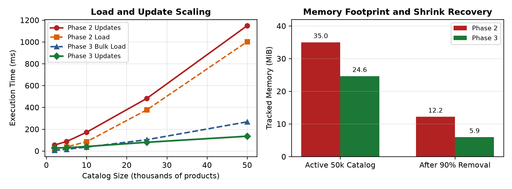
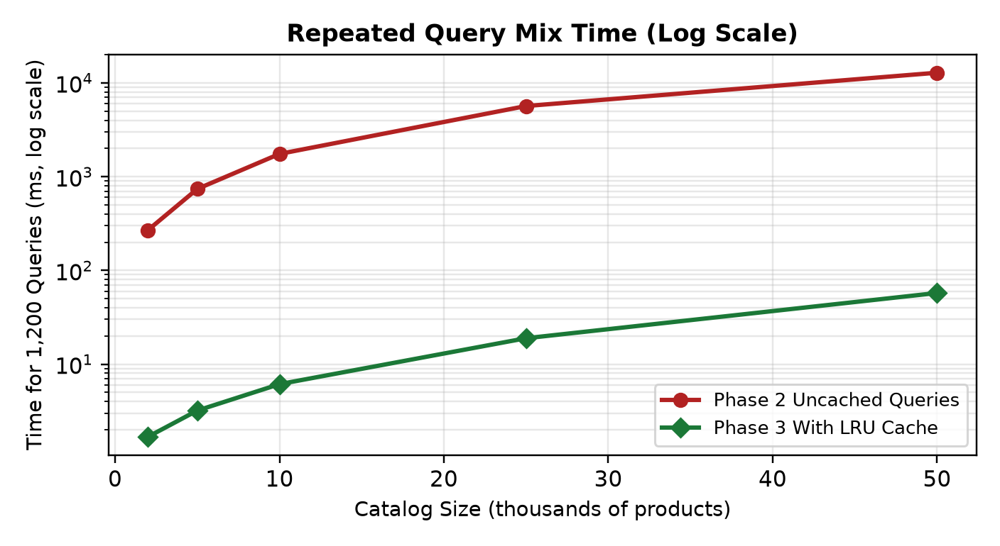

# Dynamic Inventory Management System: Phase 3

This folder contains the optimized and scaled version of the inventory management system. It upgrades the Phase 2 proof of concept so larger catalogs, frequent price and stock updates, and repeated dashboard queries run faster while using less memory.

Repository: [MSCS532 Project](https://github.com/Edgerunner26/MSCS532-Project)

## Files

| File | Purpose |
| :--- | :--- |
| `product.py` | Immutable slotted `Product` record and input validation helpers |
| `hash_table.py` | Separate chaining `HashTable` with lazy bucket slots, bulk reserve, and shrinking |
| `min_heap.py` | `MinHeap` with bottom up build and `IndexedMinHeap` for in place stock updates |
| `price_index.py` | Balanced leaf linked B plus tree for ordered price updates and range scans |
| `lru_cache.py` | Fixed capacity `LRUCache` built on a doubly linked list and `HashTable` |
| `inventory_manager.py` | `InventoryManager` coordinating indexes, atomic batch loads, and query caches |
| `main.py` | Runnable demonstration of single updates, batch loading, caching, and shrinking |
| `test_inventory.py` | Automated suite of 51 unit, edge case, cache, and stress tests |
| `benchmark_phase3.py` | Scaling and memory benchmarks from 2,000 up to 50,000 products |
| `plot_phase3.py` | Script that builds comparison charts from the saved CSV files |
| `results/` | Saved benchmark CSV files and runtime and memory charts |

## Requirements

* Python 3.10 or newer (no third party packages needed for the core library, demo, tests, or benchmarks)
* `matplotlib` (only needed when regenerating charts with `plot_phase3.py`)

```bash
pip install matplotlib
```

## Running the Code

Run commands from inside the `MSCS532_Project_Phase 3` directory.

Run the demonstration script:

```bash
python main.py
```

Run all 51 automated tests:

```bash
python test_inventory.py
```

Run the scaling and memory benchmarks and rebuild the charts:

```bash
python benchmark_phase3.py
python plot_phase3.py
```

## Usage Example

```python
from inventory_manager import InventoryManager

inventory = InventoryManager()

# Load a batch of products atomically
inventory.add_many([
    ("A100", "USB Cable", "Electronics", 9.99, 40),
    ("A200", "Mouse", "Electronics", 24.50, 6),
    ("B200", "Stapler", "Office", 12.00, 3),
])

# Point and range queries
mouse = inventory.find("A200")
electronics = inventory.in_category("Electronics")
mid_priced = inventory.in_price_range(5.00, 20.00)
restock_list = inventory.low_stock(10)

# Updates keep every index and cache consistent
inventory.update_quantity("B200", 50)
inventory.update_price("A200", 18.00)
inventory.change_category("A200", "Clearance")
```

## Summary of Optimizations and Findings

1. **Ordered Price Tree (`PriceIndex`):** Phase 2 stored all `(price, sku)` pairs in one flat sorted list, so each price insert or delete shifted up to n items in O(n) time. Phase 3 replaces that flat list with a leaf linked B plus tree (`max_keys = 128`), lowering insert and delete to O(log n) while keeping range queries at O(log n + k).
2. **In Place Stock Priority Queue (`IndexedMinHeap`):** Phase 2 pushed new entries on stock changes and left stale entries in the heap until periodic O(B + n log n) rebuilds. Phase 3 tracks each SKU slot and uses hole sifting to update or remove priorities in O(log n) time in place. Heap length now always equals the exact product count, and `low_stock` walks qualifying branches without popping and pushing items back.
3. **Memory Layout and Table Shrinking:** `Product` and internal nodes use `__slots__`, `HashTable` delays list allocation on empty buckets until a key arrives, and buckets halve when load drops below 0.20. At 50,000 products with 40,000 stock updates, active memory dropped from 35.0 MiB in Phase 2 to 24.6 MiB in Phase 3. After removing 90 percent of the catalog, retained memory dropped from 12.2 MiB to 5.9 MiB.
4. **Atomic Bulk Loading (`add_many`):** Batch loading validates every record upfront, reserves hash buckets once, builds the B plus tree from sorted pairs in O(n) time after sorting, and builds the heap in O(n) time from the bottom up. Loading 50,000 products dropped from 1,002.11 ms in Phase 2 to 463.93 ms with single inserts and 266.96 ms with `add_many`.
5. **Bounded Query Caching (`LRUCache`):** Three fixed size LRU caches store recent category, price range, and low stock results as immutable tuples and return fresh list copies on hits. Updates invalidate only the affected cache entries. Across 1,200 repeated dashboard queries on 50,000 products, execution time dropped from 12,837.10 ms to 57.44 ms, while mixed price and stock updates dropped from 1,149.12 ms to 135.11 ms.

### Benchmark Summary at 50,000 Products

| Metric | Phase 2 Baseline | Phase 3 Optimized | Improvement |
| :--- | :---: | :---: | :---: |
| Load 50,000 products (single inserts) | 1,002.11 ms | 463.93 ms | 2.2x faster |
| Load 50,000 products (`add_many` batch) | 1,002.11 ms | 266.96 ms | 3.8x faster |
| 2,000 price updates + 2,000 stock updates + 40 alerts | 1,149.12 ms | 135.11 ms | 8.5x faster |
| 1,200 repeated category, price, and low stock queries | 12,837.10 ms | 57.44 ms | 223.5x faster |
| Active memory (50,000 products after 40,000 updates) | 35.0 MiB | 24.6 MiB | 29.6% less |
| Retained memory after removing 45,000 products | 12.2 MiB | 5.9 MiB | 51.3% less |




